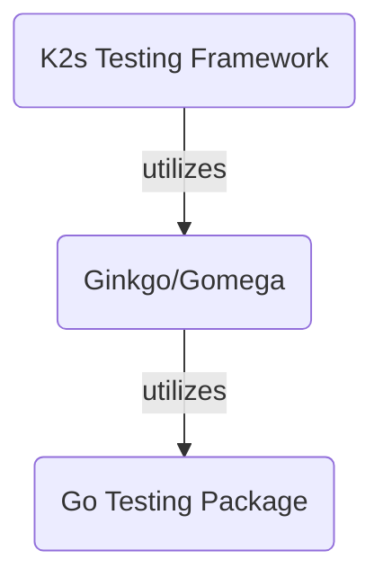

<!--
SPDX-FileCopyrightText: © 2024 The K2s Authors
SPDX-License-Identifier: MIT
-->

# Automated Testing
## Automate Everything
The ultimate goal is to automate every test case and type, i.e.:

- Unit tests
- Integration Tests
- e2e tests / system tests / acceptance tests / executable specifications (BDD-style, see also [*K2s* Acceptance Testing](#k2s-acceptance-testing))

!!! info
    Acceptance tests might require a running *K2s* cluster.

### Provisioning Hostname Checks

The provisioning hostname query allows up to four SSH attempts, with a
three-second delay between failed attempts. This retries only the read-only
`hostname` command, not installation or role-assignment operations. A failed
query is reported as an SSH failure; hostname validation runs only after a
successful query. The regression cases are in
`common-setup.module.unit.tests.ps1` under the Windows Linux-node distro module.

### Windows Workload Readiness Diagnostics

If the core acceptance suite exhausts its Windows HTTP readiness retries, it
collects evidence without changing the readiness criteria. The suite probes
Service DNS, Service ClusterIPs, and EndpointSlice Pod IPs from both the host
and the Linux curl pod. It also captures Kubernetes resources, forwarding
logs, and Windows adapter, route, and HNS state. These observations help
distinguish DNS, Service forwarding, and direct endpoint failures; they do
not identify the failing component on their own.

Diagnostic commands have a ten-second timeout and share a four-minute
collection budget. Query and probe failures are recorded without replacing
the original readiness failure or preventing independent probes.

### Cross-Node Communication Diagnostics

The node acceptance suite preserves curl error output (`-sS`) for pod
communication checks. On failure, it probes the same destination's Service IP
and direct Pod IP from the failing source container, without DNS or proxy use.
The generated node workloads use port 80 for both paths.

Failure-only collection also records the Service, EndpointSlices, pods, nodes,
Flannel/kube-proxy logs, and Windows routes/HNS state. For participating Linux
nodes with known SSH configuration, it collects host routes, route lookups,
and iptables counters using the existing key and strict host-key checking.
Missing tools, SSH access, and diagnostic failures are reported without
replacing the original assertion failure. Collection has a two-minute overall
budget and a ten-second limit per command; it does not retry the test or
change network state. Evidence appears under `NODE-NET DIAG` in test output.

## Prerequisites
[Install *Pester*](#install-pester) and [Install *Ginkgo*](https://onsi.github.io/ginkgo/#installing-ginkgo){target="_blank"}.

!!! tip
    When running the [Main Script: execute_all_tests.ps1](#main-script-execute_all_testsps1) for the first time, those prerequisites are installed automatically in the correct version.

## Windows Cluster GitHub Actions Workflow

The **CI - Windows Cluster** workflow (`.github/workflows/ci-windows-cluster.yml`)
builds all ten Windows executables, runs `k2s install`, verifies that both the
Linux control plane and Windows worker are Ready, and runs the existing
`test/e2e/cluster/core` acceptance suite. The suite deploys Linux and Windows
workloads and checks DNS, Service forwarding, cross-node connectivity and
internet access. This is a core cluster test, not the complete addon or
lifecycle test matrix.

### Runner Contract with the KubeVirt Dispatcher

The default target is the **disposable x64 Windows 11 `cibox-win11` VM**
provisioned by the `k2s-support` dispatcher. The job requests exactly
`runs-on: [self-hosted, k2s-win11-runner]`; the dispatcher must include both
labels in its JIT registration. Windows 11 editions with Hyper-V support
(including appropriately licensed Enterprise/IoT Enterprise), and Windows
Server 2022/2025 are accepted by the preflight checks. Do not assume that
`windows-latest` or an arbitrary larger runner exposes nested virtualization.
The workflow requires at least 8 logical CPUs, 16 GiB RAM (32 GiB recommended),
10 GiB free RAM and 100 GiB free disk space on the `C:` system drive. The
control-plane VM receives 6 CPUs, 6 GiB static memory and a 50 GiB disk.

The support-side Argo automation boots the Windows VM without cloning,
building or installing K2s. It downloads the Actions runner, supplies a
short-lived JIT configuration and runs `run.cmd --jitconfig <encoded-config>`.
This workflow owns checkout, builds, install, tests and native per-step logs.
No Argo API, Kubernetes credentials, GitHub App key or runner-administration
permission is needed in the Actions job; its token has only `contents: read`.
The dispatcher and runner connect outbound through the corporate proxy;
no public Kubernetes API or inbound webhook is needed.

On KubeVirt, expose VMX/SVM to the Windows guest and retain the already-tested
nested Hyper-V configuration in the base image. On an outer Hyper-V host,
configure the powered-off runner VM there, not inside the job:

```powershell
Set-VMProcessor -VMName '<runner-vm>' -ExposeVirtualizationExtensions $true
Set-VMMemory -VMName '<runner-vm>' -DynamicMemoryEnabled $false
```

For Azure or another cloud, select a VM family/size and security configuration
that explicitly supports nested Hyper-V; enabling Windows features alone does
not provide this capability. For physical runners, enable virtualization in
firmware. The workflow creates, starts and removes a diskless probe VM to
verify actual VM startup, rather than relying only on CPU flags.

Prepare the base image with these features in elevated Windows PowerShell,
then **reboot before generating/starting the JIT runner**:

```powershell
Enable-WindowsOptionalFeature -Online -FeatureName @(
    'Microsoft-Hyper-V',
    'Microsoft-Hyper-V-Management-PowerShell',
    'Containers',
    'VirtualMachinePlatform'
) -All -NoRestart
# On Windows 11, also enable the complete client Hyper-V feature set.
Enable-WindowsOptionalFeature -Online -FeatureName 'Microsoft-Hyper-V-All' -All -NoRestart
Set-ExecutionPolicy RemoteSigned -Force
Restart-Computer
```

Install the Microsoft Visual C++ v14 **x64** redistributable, `curl.exe`
>= 7.71.0, OpenSSH >= 8, and Git. Run the Actions runner with an elevated local
administrator token and a usable profile; the job uses Windows PowerShell 5.1.
Go is installed by `actions/setup-go`, using the version from `go.mod`.
No preinstalled `k2s.exe`, K2s checkout, Ginkgo or Pester is needed. The
`Microsoft-Hyper-V-All` command is client-specific; omit it on Server.

Stop Docker Desktop/Engine. Start with no existing K2s installation, Hyper-V
VMs, external virtual switches or `C:\k2s` staging folder. Allow downloads
and registry access from the host and nested VM, including the configured
`shsk2s.azurecr.io` registry. Ensure host/VPN/cloud networks do not overlap the
subnets in `cfg/config.json` (by default `172.19.1.0/24`, `172.20.0.0/16`,
`172.21.0.0/16` and `172.22.1.0/24`). Preserve GitHub runner connectivity when
K2s creates switches and changes DNS/routing. K2s uses internal switches/NAT;
do not create an external switch on the runner to provide nested networking.

### Corporate Proxy Configuration

Configure the Actions runner's **process environment** (or runner `.env`)
with its proxy before launching `run.cmd`. Checkout, setup-go and artifact
upload need that configuration independently of the PowerShell steps. Node
proxy settings do not automatically configure the Windows guest or its
nested Linux VM. Install any corporate TLS CA certificates in each relevant
trust store; do not disable certificate validation.

For Go builds, tests and K2s installation, the workflow uses the optional
`K2S_HTTP_PROXY` environment/repository variable, then inherited `HTTPS_PROXY`,
then `HTTP_PROXY`. Configure an absolute HTTP(S) URL reachable from both the
Windows host and Kubemaster, without embedded credentials. No corporate
address is hard-coded. If these are unset, K2s can use the runner account's
Windows proxy settings through its existing installer behavior; Go and the
Actions agent still need their own working connectivity.

`K2S_NO_PROXY` optionally supplies additional comma-separated corporate
bypasses. Build/test steps merge these with inherited `NO_PROXY` and the
cluster addresses/CIDRs read from `cfg/config.json`. Installation passes the
proxy and bypasses through `k2s install --proxy ... --no-proxy ...`, then clears
proxy environment variables only in that step's child process. CLI-only
status, diagnostics and uninstall steps also clear their child-process
proxy variables. The parent runner retains its connectivity for job control
and artifact upload.

Do not set machine-level `HTTP_PROXY`, `HTTPS_PROXY`, `NO_PROXY` or `ALL_PROXY`
in the base image; preflight rejects them rather than modifying persistent
settings. K2s validates machine and process proxy environments, so clearing
only the child environment would not isolate an invalid machine configuration.
The runner's `.env`, JIT config and diagnostic credentials must remain outside
`GITHUB_WORKSPACE`/`C:\k2s`; they are not workflow artifacts.

### Dispatch, Results and Runner Disposal

Create the `k2s-windows-e2e` GitHub environment with required reviewers and
deployment branch restrictions, and restrict the runner group to trusted
repositories/workflows. Under **Actions > CI - Windows Cluster > Run workflow**,
select a reviewed branch. To test a PR, dispatch its reviewed head branch
within this repository; do not execute untrusted fork code on this runner.
There are deliberately no `pull_request` or `pull_request_target` triggers.
Runs share the `k2s-win11-runner` concurrency group and do not cancel an active
installation. Other workflows targeting this same support-side pool/shared
reporting PVC must use the same group, or the dispatcher must enforce a
global capacity limit. GitHub concurrency alone does not coordinate Argo
workflows or other repositories.

Configure the protected environment **before** dispatching, including required
reviewers and deployment branch restrictions; merely naming an environment in
YAML does not establish an approval policy. The dispatcher must only provision
approved, runnable jobs and should restrict eligible workflow paths/refs.

JIT guarantees a single-use runner, **not binding to the polled job ID**:
GitHub assigns a matching queued job using labels/group access. Deterministic
Argo names deduplicate provisioning attempts, not GitHub job assignment.
Use compatible labels, restricted access and pool limits; do not assume the
runner necessarily executes the job that caused its creation. Include run
attempts in dispatcher deduplication so reruns are not suppressed.

Source (including credential-free Git metadata for build version information)
is staged at `C:\k2s` because installation on the system drive is recommended.
The workflow uses the repository's `BuildGoExe.ps1 -BuildAll` helper before:

```console
C:\k2s\k2s.exe install --master-cpus 6 --master-memory 6GB --master-disk 50GB --output
```

Ginkgo is invoked through `go run` at the version pinned in `go.mod`, with one
process and `--fail-on-empty`. JUnit results, failure-only Kubernetes/Hyper-V
diagnostics and `k2s.log` are retained for seven days. Logs may contain internal
network information; review them before sharing. Kubeconfigs, SSH keys and
full system dumps are not uploaded.

The job attempts `k2s uninstall --output` even after installation/test failure
and uploads evidence first. The support-side provisioner must wait for the
runner to finish the entire job, including post-job actions, before its Argo
`onExit` destroys the VMI, SSH Service and per-job writable storage.
**Discard/reimage the runner VM after every run**, including success,
cancellation or timeout; single-use registration alone does not delete it.
Uninstall cannot restore all machine changes: installation modifies networking, Windows services,
registry settings and Defender settings. Partial installs may also leave
provisioning VMs. Never reuse this runner for unrelated jobs or treat workflow
cleanup as a substitute for VM disposal.

The Actions job timeout is **240 minutes**. The support-side deadline must
allow VM boot, registration, all 240 job minutes, runner exit and teardown:
use at least **5 hours**, increasing it if provisioning requires longer.
A four-hour Argo deadline could destroy a still-running job. Bound idle
registration/queue waiting separately; a JIT runner must not be assumed to
exit immediately when no job is assigned. Timeouts/cancellation may prevent
Actions cleanup, so Argo needs independent cleanup plus a stale-resource
reaper. Delete per-job JIT Secrets and stale runner registrations too.

Dispatcher implementation and RBAC live in `k2s-support`, not this repository.
JIT Secret creation followed by Workflow submission is not an atomic claim:
handle duplicate/partial submissions and reconcile orphan Secrets/runners.
Its documented dispatcher permissions must cover every API operation it
actually uses (including reading existing claims and any token-cache Secret),
without exposing those permissions or credentials to the Windows guest.
Mount the per-job JIT Secret in each Argo pod that actually copies/uses it;
mounts in a caller pod are not automatically inherited by referenced templates.
  
## Main Script: execute_all_tests.ps1
The main entry point for automated testing is the script `execute_all_tests.ps1`, whether being executed locally or in CI/CD workflows. It is not mandatory, but recommended to use this script instead of running *Pester* or *Ginkgo* commands directly due to the following features of the `execute_all_tests.ps1` script:

- Run all test suites in this repository (*PowerShell*- or *Go*-based tests)
- Automatic installation of the required testing frameworks on-the-fly when they do not exist in the required version (i.e. *Pester* and *Ginkgo*)
- Tags/labels filtering that applies both to *PowerShell* and *Go*
- Options to exclude either *PowerShell* or *Go* tests
- Unified test execution report

!!! example
    ```powershell
    <repo>\test\execute_all_tests.ps1 -Tags unit -ExcludeGoTests
    ```

The preceding example would execute all *PowerShell*-based tests tagged with `unit`.

!!! tip
    Inspect the [execute_all_tests.ps1](https://github.com/k2s-project/k2s/blob/main/test/execute_all_tests.ps1){target="_blank"} script for further parameter details and descriptions.<br/>
    See [Commonly Used Tags](tags-labels.md#commonly-used-tags) for commonly used labels/tags.
    
## Automated Testing with Pester
!!! note
    For a quick start and command overview, see [Pester Quick Start](https://pester.dev/docs/quick-start){target="_blank"}.
### Install Pester
!!! info
    [Pester](https://github.com/pester/Pester){target="_blank"} comes pre-installed on Win 10 or later.

To check the installed version, run:
```PowerShell
Import-Module Pester -Passthru
```

This output will be similar to:
``` title="Output"
ModuleType Version    Name    ExportedCommands
---------- -------    ----    ----------------
Script     3.4.0      Pester  {AfterAll, AfterEach, Assert-MockCalled, Assert-VerifiableMocks...}
```
!!! tip
    It is highly recommended to update Pester to the latest version to have a consistent set of test APIs.
 
### Update Pester
If Pester was not installed explicitly yet (i.e., the version shipped with Windows is installed), run:
```PowerShell
Install-Module Pester -Force -SkipPublisherCheck
```

For subsequent updates, run:
```PowerShell
Update-Module -Name Pester
```

### Run Pester
To start test discovery and execution, run:
```PowerShell
Invoke-Pester .\<test file>.tests.ps1
```
!!! info
    Pester discovers test files via naming convention **\*.\[T|t\]ests.ps1**

To see detailed output, run:
```PowerShell
Invoke-Pester -Output Detailed .\<test file>.Tests.ps1
```
To include/exclude tests by tags, run:
```PowerShell
Invoke-Pester -Tag "acceptance" -ExcludeTag "slow", "linuxOnly" .\<test file>.Tests.ps1
```

#### Code Coverage
To calculate the code coverage of a test run, additionally specify the file(s) under test:
```PowerShell
Invoke-Pester .\<test file>.Tests.ps1 -CodeCoverage .\<file-under-test>.ps1
```

To export the code coverage results as [JaCoCo](https://www.jacoco.org/){target="_blank"} XML file, specify the output file:
```PowerShell
Invoke-Pester .\<test file>.Tests.ps1 -CodeCoverage .\<file-under-test>.ps1 -CodeCoverageOutputFile <some dir>\coverage.xml
```

!!! note
    See [Pester Code Coverage](https://pester.dev/docs/usage/code-coverage/){target="_blank"} for more options.

### Log Output Redirection
When executing *K2s* scripts inside *Pester* test functions, it is recommended to execute these scripts in a separate *PowerShell* session, so that the called scripts still log to the *K2s* log files due to the current logging implementation.

#### Don't
```PowerShell
# ...
$enableScript = "$PSScriptRoot\Enable.ps1"
# ...
It 'does not log to log file :-(' {
    $output = $(&$enableScript -ShowLogs) *>&1 # output redirect, but no log file entries
    # ...
}
# ...
```

#### Do
```PowerShell
# ...
$enableScript = "$PSScriptRoot\Enable.ps1"
# ...
It 'logs to log file :-)' {
    $output = powershell -Command "$enableScript -ShowLogs" *>&1 # output redirect and log file entries
    # ...
}
# ...
```

### Suppress Code Analysis
*Pester* requires a certain test code structure that can lead to code analyzer warnings, e.g. in this case:
```PowerShell
BeforeAll {
    $module = "$PSScriptRoot\setupinfo.module.psm1"

    $moduleName = (Import-Module $module -PassThru -Force).Name
}
```
The analyzer would complain:
!!! quote
    The variable 'moduleName' is assigned but never used. *PSScriptAnalyzer(PSUseDeclaredVarsMoreThanAssignments)*

To mitigate this, suppress this warning like the following:
```PowerShell
BeforeAll {
    $module = "$PSScriptRoot\setupinfo.module.psm1"

    [Diagnostics.CodeAnalysis.SuppressMessageAttribute('UseDeclaredVarsMoreThanAssignments', '', Justification = 'Pester Test')]
    $moduleName = (Import-Module $module -PassThru -Force).Name
}
```

## Automated Testing with Ginkgo/Gomega
### Log Output Redirection
For diagnostic logging, *k2s* CLI uses [slog](https://pkg.go.dev/log/slog){target="_blank"}. To redirect the log output to *Ginkgo*, set the *Ginkgo* logger as follows (*Ginkgo* uses [logr](https://github.com/go-logr/logr/){target="_blank"} internally):
```go
var _ = BeforeSuite(func() {
	slog.SetDefault(slog.New(logr.ToSlogHandler(GinkgoLogr)))
})
```

This enables control over *slog* output, i.e. the output can be enabled when running *Ginkgo* in verbose mode (`ginkog -v`) and be omitted in non-verbose mode.

### *K2s* Acceptance Testing
!!! info
    **The acceptance tests focus on testing *K2s* from a user's point of view** in an automated, repeatable and reproduceable fashion. They are intended to cover all available features across the various [Supported OS Versions](../../op-manual/os-support.md). They are not intended to cover all the edge and corner cases, though (Unit Tests might be a better fit there).

**To mark acceptance tests as such** and provide additional information about test prerequisites (e.g. a running *K2s* cluster, internet connectivity, etc.), **use [Tags/Labels](tags-labels.md)**.

#### Tech Stack
The tech stack mostly comprises the [*Go* testing package](https://pkg.go.dev/testing){target="_blank"}, [*Ginkgo*](https://onsi.github.io/ginkgo/#top){target="_blank"}/[*Gomega*](https://onsi.github.io/gomega/#top){target="_blank"} and the *[K2s Testing Framework](https://github.com/k2s-project/k2s/blob/main/k2s/test/framework/README.md){target="_blank"}* to write acceptance tests in an efficient way without having to write boilerplate code repeatedly. The levels of abstraction are depicted in the following:



#### Implementing Tests/Specs
See [*K2s* Acceptance Tests/Specs](https://github.com/k2s-project/k2s/blob/main/k2s/test/README.md){target="_blank"}.

#### Executing Tests/Specs
Multiple options exist to run *Go*-based test specs:

- [Main Script: execute_all_tests.ps1](#main-script-execute_all_testsps1) - Recommended, provides most flexibility
- Running *Ginkgo*:
    ```console
    ginkgo <dir-with-test-specs>
    ```
- Running `go test`:
    ```console
    cd <dir-with-test-specs>
    go test 
    ```

!!! tip "Ginkgo and go test"
    Use `-v` flag to enable verbose test execution output.
    
    Use `-r` or `./...` to scan for and execute tests recursively starting in the given directory.

!!! tip "Optimizing Test Execution Speed"
    When executing *Go*-based tests, the packages containing the test specs will get built right before test execution. This compilation is rather time-consuming compared to the actual test runs, especially when executing short-running unit tests.

    To optimize the overall execution speed, the packages containing test specs can be build before hand, either through `ginkgo build` or `go test -c`.