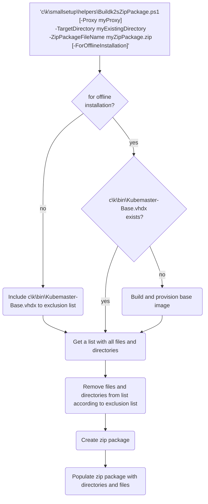

<!--
SPDX-FileCopyrightText: © 2026 The K2s Authors
SPDX-License-Identifier: Apache-2.0
-->

# Creating Offline Package
## *K2s* Offline Package
*K2s* provides support for creating an offline installation package[^1].

[^1]: Creating of and installing from an offline package is currently supported for [Host Variant](../user-guide/hosting-variants.md#host-default) and [Development-Only](../user-guide/hosting-variants.md#development-only) only.

No *K2s* cluster must be installed in order to create an offline package.

To inspect various parameter options, run:
```console
<repo>\k2s.exe system package -h
```

To create a fully offline-capable install package, set the `--for-offline-installation` flag:
```console
<repo>\k2s.exe system package -d <path-to-output-packe>.zip --for-offline-installation
```

### Addon Selection

By default, all addons are included in the package. To customize which addons are included, use the `--addons-list` flag:

```console
# Include only specific addons
k2s system package -d C:\output -n k2s.zip --addons-list "ingress nginx,monitoring,logging"

# Exclude all addons from the package
k2s system package -d C:\output -n k2s.zip --addons-list none
```

!!! note
    For multi-implementation addons like *ingress*, specify the implementation name separated by a space (e.g., `ingress nginx` or `ingress traefik`).

The `--addons-list` flag works with both *Dev* (default) and *Lite* profiles.

The *Lite* profile reduces package size by excluding optional build artifacts and large intermediate artifacts. Documentation and test code for delivered components remain included: when all addons are packaged, addon tests are included as well; when `--addons-list` limits the delivery, only tests for the selected addons are kept.

When running the aforementioned command and no *K2s* variant has been installed on the current system yet, the [Development-Only Variant](../user-guide/hosting-variants.md#development-only) will be installed in order to create an offline package (which requires an internet connection). If all dependencies are already available locally due to prior installation of *K2s*, the offline package creation does not require internet connection.

??? info "Offline Package Creation Diagram"


!!! note
    Omitting the `--for-offline-installation` flag will effectively bundle only repository source files similar to the [*K2s* Releases](https://github.com/k2s-project/k2s/releases){target="_blank"}.

## Node Package for Offline Node Add

To add a Linux worker node to an existing cluster without internet access on that node, create a **node package**.

Node package creation requires an existing *K2s* cluster on the machine where you run the command, and it must use the local cluster proxy `http://172.19.1.1:8181`.

Inspect the available options:

```console
k2s system package -h
```

Example from a local directory using `k2s.exe` directly:

```console
.\k2s.exe system package --node-package --os debian12 --target-dir "D:\Linuxpackagetest" --name "debian12.zip" --proxy http://172.19.1.1:8181
```

Create an OS-specific node package ZIP:

```console
k2s system package --node-package --os debian12 --target-dir "C:\out" --name "debian12-node.zip" -p http://172.19.1.1:8181
```

Example for Debian 13:

```console
k2s system package --node-package --os debian13 --target-dir "C:\out" --name "debian13-node.zip" -p http://172.19.1.1:8181
```

Then add the node by passing the package to `k2s node add`:

```console
k2s node add --ip-addr <IPAddressOfNewNode> --username <UserNameForRemoteConnection> --node-package C:\out\debian13-node.zip
```

!!! note
    The node package is intended for extending an existing cluster with a Linux worker node. It is separate from the full offline installation package used for installing *K2s* itself.

See [Extending K2s cluster](extending-k2s-cluster.md) for the complete node onboarding workflow.

### GPU-Enabled Node Package

To add a Linux worker node **with GPU support** in an air-gapped environment, include the NVIDIA Container Toolkit packages in the node package:

```console
k2s system package --node-package --os debian13 --include-gpu --target-dir C:\output --name debian13-node-gpu.zip
```

The `--include-gpu` flag downloads and bundles:

| Component | Purpose |
|-----------|---------|
| `libnvidia-container1` | Low-level library for container GPU access |
| `libnvidia-container-tools` | CLI tools for NVIDIA container runtime || `nvidia-container-toolkit-base` | Base library for nvidia-container-toolkit || `nvidia-container-runtime` | OCI-compliant runtime wrapper |
| `nvidia-container-toolkit` | High-level toolkit and configuration |
| GPU device plugin image | Kubernetes device plugin for GPU scheduling |

When using a GPU-enabled node package:

```console
k2s node add --ip-addr <IPAddressOfNewNode> --username <UserNameForRemoteConnection> --node-package C:\output\debian13-node-gpu.zip
```

K2s automatically detects if the target node has an NVIDIA GPU and configures GPU support:

- If an NVIDIA GPU is detected → installs toolkit from package, configures CRI-O, labels node
- If no NVIDIA GPU is detected → skips GPU configuration, node joins as regular worker

!!! warning "NVIDIA Drivers Required"
    The target node must have NVIDIA kernel drivers pre-installed. Verify with `nvidia-smi` before running `k2s node add`. K2s does **not** install kernel drivers.

See [GPU Node addon](../user-guide/gpu-node.md#external-gpu-worker-nodes) for complete GPU worker documentation.

## Addons Offline Package
To enable addons without an internet connection being available, the required binaries can be exported to an offline package as well.

### Addons Export
To inspect all export options, run:
```console
k2s addons export -h
```

Either specify one or more addons to export:
```console
k2s addons export registry -d <export-output-directory>
```

Or export all addons:
```console
k2s addons export -d <export-output-directory>
```

To export without container images (produces a lighter artifact):
```console
k2s addons export registry -d <export-output-directory> --omit-images
```

To export without packages (Debian, Linux, and Windows packages):
```console
k2s addons export registry -d <export-output-directory> --omit-packages
```

Both flags can be combined to export only configuration, manifests, and scripts:
```console
k2s addons export registry -d <export-output-directory> --omit-images --omit-packages
```

### Addons Import
To inspect all export options, run:
```console
k2s addons import -h
```

Either specify one or more addons to import from the offline package:
```console
k2s addons import registry -f <directory-containing-addons-archive>\addons.zip
```

Or import all addons from the offline package:
```console
k2s addons import -f <directory-containing-addons-archive>\addons.zip
```

!!! note
    Importing a specific addon from the offline package does obviously not work when this package does not contain the specified addon.

After importing an addon, it can be enabled without internet connection being available.

## Delta Packages

For bandwidth-efficient upgrades, *K2s* supports creating delta packages that contain only the files changed between two versions. This significantly reduces package size for minor and patch upgrades.

See [Delta Packages](delta-packages.md) for detailed documentation on creating and applying delta packages.